# Blog

[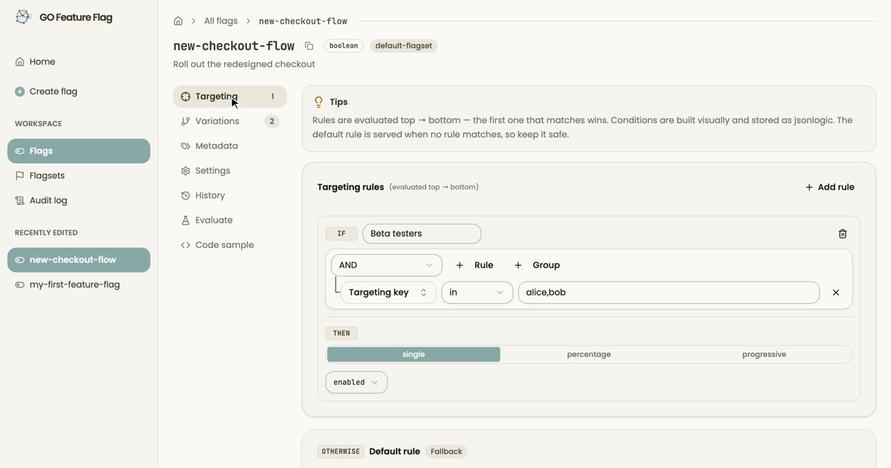](https://gofeatureflag.org/blog/2026/11/04/introducing-goff-studio.md)

[Latest articleProduct](https://gofeatureflag.org/blog/2026/11/04/introducing-goff-studio.md)

## [🎨 A first look at GO Feature Flag Studio](https://gofeatureflag.org/blog/2026/11/04/introducing-goff-studio.md)

[GO Feature Flag Studio is an optional web UI to manage your feature flags on top of GO Feature Flag. It is still in development; here is a first demo of what it looks like.](https://gofeatureflag.org/blog/2026/11/04/introducing-goff-studio.md)

[Thomas Poignant · 3 min read](https://gofeatureflag.org/blog/2026/11/04/introducing-goff-studio.md)

[Read article →](https://gofeatureflag.org/blog/2026/11/04/introducing-goff-studio.md)

Filter articles by category

All articles29Product14Engineering8Community5Case study2

[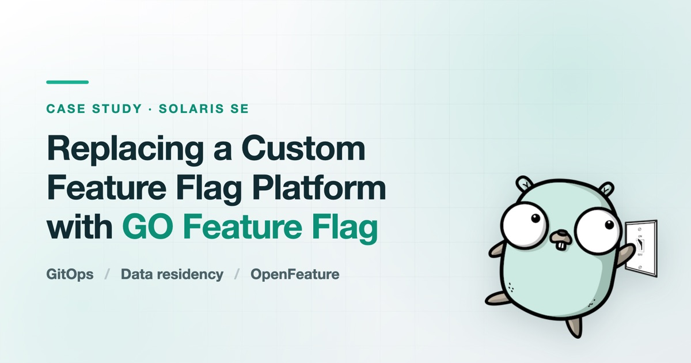](https://gofeatureflag.org/blog/solaris-go-feature-flag-case-study.md)

[Case study](https://gofeatureflag.org/blog/solaris-go-feature-flag-case-study.md)

### [Replacing a Custom Feature Flag Platform at Solaris: GitOps, Data Residency and OpenFeature](https://gofeatureflag.org/blog/solaris-go-feature-flag-case-study.md)

[Why a German Banking-as-a-Service provider retired its in-house toggle system for GO Feature Flag, after weighing it against seven alternatives under hard EU data residency and zero-budget constraints.](https://gofeatureflag.org/blog/solaris-go-feature-flag-case-study.md)

[Olivier Laviale · 10 min read](https://gofeatureflag.org/blog/solaris-go-feature-flag-case-study.md)

[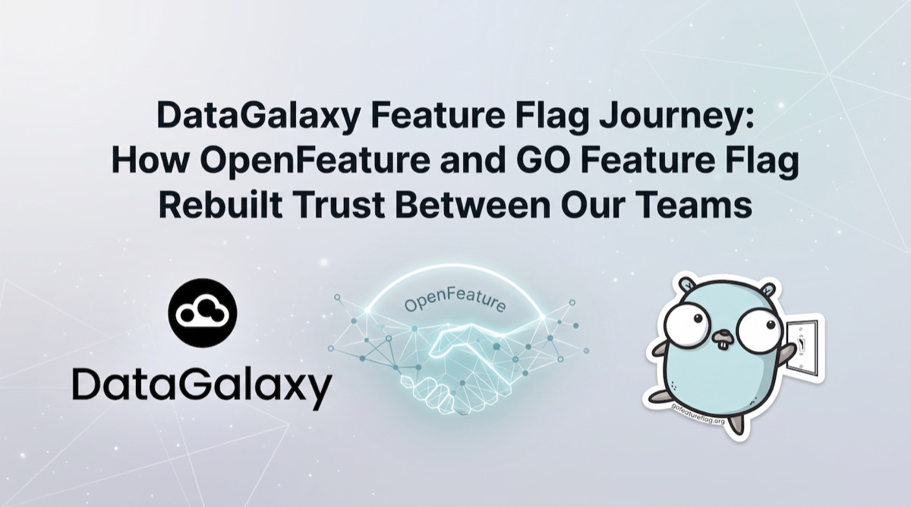](https://gofeatureflag.org/blog/datagalaxy-go-feature-flag-case-study.md)

[Case study](https://gofeatureflag.org/blog/datagalaxy-go-feature-flag-case-study.md)

### [DataGalaxy Feature Flag Journey: How OpenFeature and GO Feature Flag Rebuilt Trust Between Teams](https://gofeatureflag.org/blog/datagalaxy-go-feature-flag-case-study.md)

[How DataGalaxy replaced four ad-hoc flag mechanisms with OpenFeature and the GO Feature Flag relay proxy — and unlocked trunk-based development along the way.](https://gofeatureflag.org/blog/datagalaxy-go-feature-flag-case-study.md)

[Tom Flenner · 16 min read](https://gofeatureflag.org/blog/datagalaxy-go-feature-flag-case-study.md)

[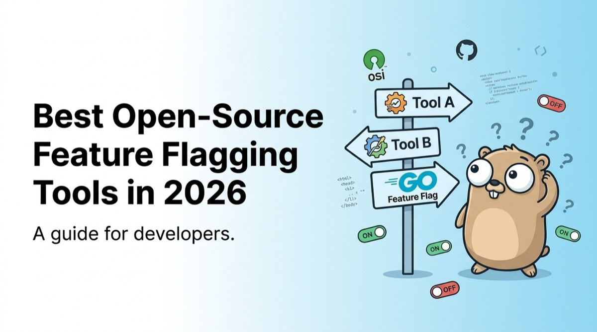](https://gofeatureflag.org/blog/best-opensource-feature-flag-tools.md)

[Engineering](https://gofeatureflag.org/blog/best-opensource-feature-flag-tools.md)

### [Best Open-Source Feature Flagging Tools in 2026](https://gofeatureflag.org/blog/best-opensource-feature-flag-tools.md)

[The best open-source feature flag tools in 2026, compared through the OpenFeature standard — so you choose for capability, not lock-in.](https://gofeatureflag.org/blog/best-opensource-feature-flag-tools.md)

[Thomas Poignant · 14 min read](https://gofeatureflag.org/blog/best-opensource-feature-flag-tools.md)

[Engineering](https://gofeatureflag.org/blog/2026/05/02/ai-tooling-go-feature-flag.md)

### [AI Tooling for GO Feature Flag and OpenFeature](https://gofeatureflag.org/blog/2026/05/02/ai-tooling-go-feature-flag.md)

[Community-built skills and an MCP server that improve the AI-assisted developer experience when working with GO Feature Flag and OpenFeature.](https://gofeatureflag.org/blog/2026/05/02/ai-tooling-go-feature-flag.md)

[Thomas Poignant · 4 min read](https://gofeatureflag.org/blog/2026/05/02/ai-tooling-go-feature-flag.md)

[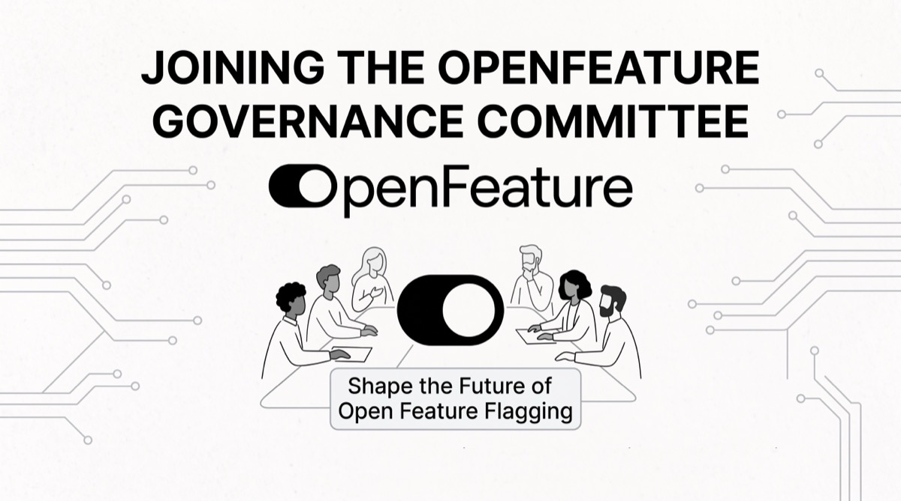](https://gofeatureflag.org/blog/2026/04/09/openfeature-governance-committee.md)

[Community](https://gofeatureflag.org/blog/2026/04/09/openfeature-governance-committee.md)

### [Joining the OpenFeature Governance Committee](https://gofeatureflag.org/blog/2026/04/09/openfeature-governance-committee.md)

[Thomas Poignant, creator of GO Feature Flag, has been elected to the OpenFeature Governance Committee for the 2026-2028 term.](https://gofeatureflag.org/blog/2026/04/09/openfeature-governance-committee.md)

[Thomas Poignant · 3 min read](https://gofeatureflag.org/blog/2026/04/09/openfeature-governance-committee.md)

[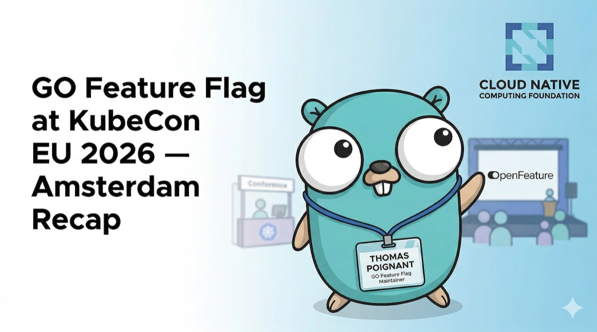](https://gofeatureflag.org/blog/2026/04/07/kubecon-amsterdam-2026.md)

[Community](https://gofeatureflag.org/blog/2026/04/07/kubecon-amsterdam-2026.md)

### [GO Feature Flag at KubeCon EU 2026 — Amsterdam Recap](https://gofeatureflag.org/blog/2026/04/07/kubecon-amsterdam-2026.md)

[A look back at our week in Amsterdam at KubeCon + CloudNativeCon Europe 2026.](https://gofeatureflag.org/blog/2026/04/07/kubecon-amsterdam-2026.md)

[Thomas Poignant · 4 min read](https://gofeatureflag.org/blog/2026/04/07/kubecon-amsterdam-2026.md)

[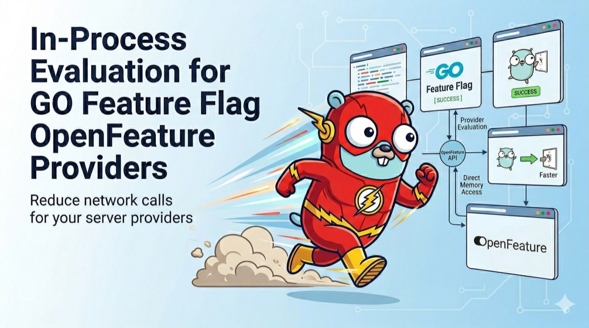](https://gofeatureflag.org/blog/2026/03/31/in-process-openfeature-providers.md)

[Product](https://gofeatureflag.org/blog/2026/03/31/in-process-openfeature-providers.md)

### [In-Process Evaluation for GO Feature Flag OpenFeature Providers](https://gofeatureflag.org/blog/2026/03/31/in-process-openfeature-providers.md)

[GO, Java, .NET, Python, and JavaScript/TypeScript providers now support in-process evaluation for faster flag resolution with far fewer network calls.](https://gofeatureflag.org/blog/2026/03/31/in-process-openfeature-providers.md)

[Thomas Poignant · 4 min read](https://gofeatureflag.org/blog/2026/03/31/in-process-openfeature-providers.md)

[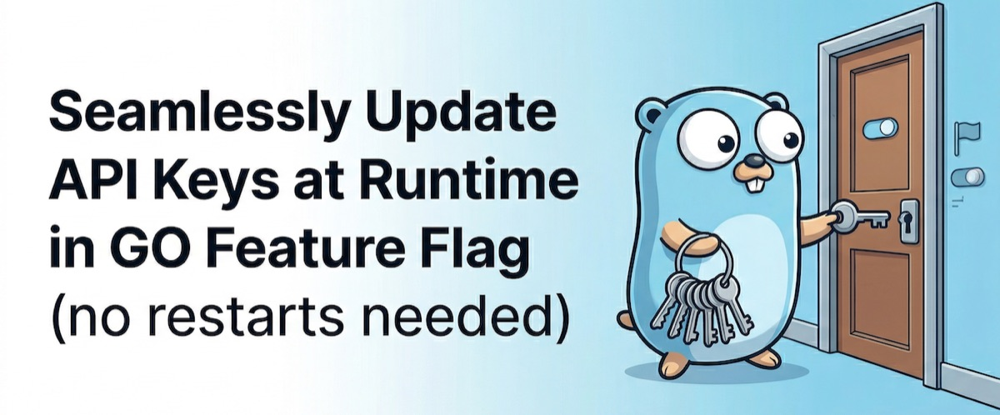](https://gofeatureflag.org/blog/2026/01/07/runtime-api-key-updates.md)

[Product](https://gofeatureflag.org/blog/2026/01/07/runtime-api-key-updates.md)

### [Seamlessly Update API Keys at Runtime in GO Feature Flag (No Restarts Needed)](https://gofeatureflag.org/blog/2026/01/07/runtime-api-key-updates.md)

[Discover how GO Feature Flag's new runtime API key update feature enables you to update API keys without restarting the relay proxy, ensuring continuous availability and improved security.](https://gofeatureflag.org/blog/2026/01/07/runtime-api-key-updates.md)

[Thomas Poignant · 4 min read](https://gofeatureflag.org/blog/2026/01/07/runtime-api-key-updates.md)

[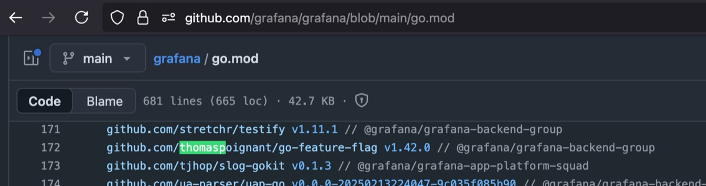](https://gofeatureflag.org/blog/2025/10/03/grafana-using-go-feature-flag.md)

[Community](https://gofeatureflag.org/blog/2025/10/03/grafana-using-go-feature-flag.md)

### [Grafana is Now Using GO Feature Flag 🎉](https://gofeatureflag.org/blog/2025/10/03/grafana-using-go-feature-flag.md)

[We’re proud to announce that Grafana, one of the world’s most popular observability platforms, is now using GO Feature Flag as a dependency in their project! 🚀](https://gofeatureflag.org/blog/2025/10/03/grafana-using-go-feature-flag.md)

[Thomas Poignant · 2 min read](https://gofeatureflag.org/blog/2025/10/03/grafana-using-go-feature-flag.md)

[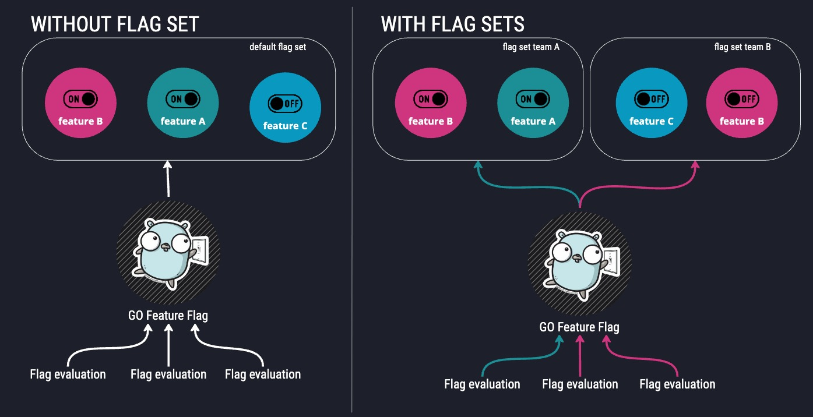](https://gofeatureflag.org/blog/2025/09/18/introducing-flagsets.md)

[Product](https://gofeatureflag.org/blog/2025/09/18/introducing-flagsets.md)

### [🏗️ Introducing Flag Sets: Organize Your Feature Flags Like Never Before](https://gofeatureflag.org/blog/2025/09/18/introducing-flagsets.md)

[Discover how GO Feature Flag's new flag sets feature enables better organization, team isolation, and multi-tenant support for your feature flag management.](https://gofeatureflag.org/blog/2025/09/18/introducing-flagsets.md)

[Thomas Poignant · 6 min read](https://gofeatureflag.org/blog/2025/09/18/introducing-flagsets.md)

[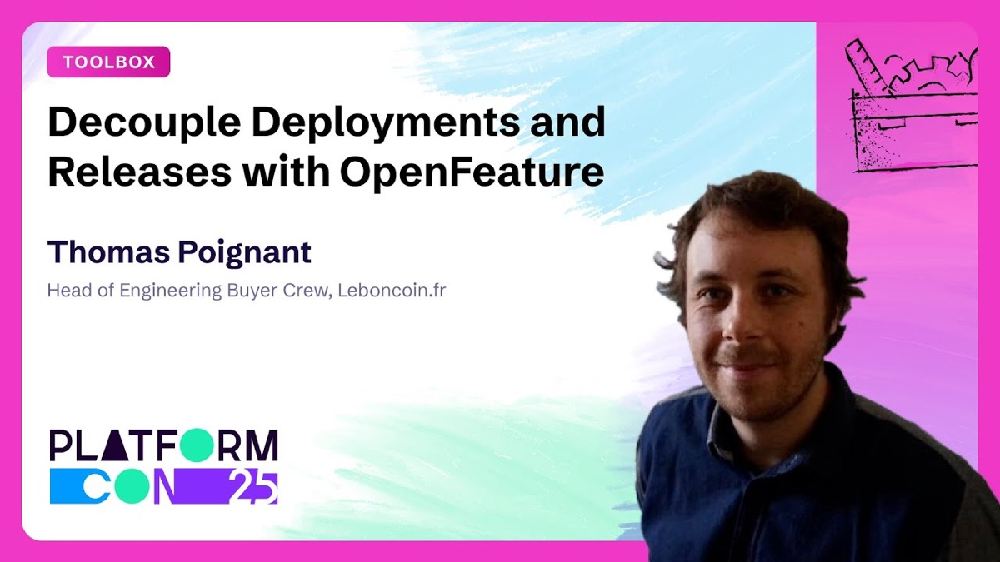](https://gofeatureflag.org/blog/2025/07/01/platformcon-2025-talk.md)

[Community](https://gofeatureflag.org/blog/2025/07/01/platformcon-2025-talk.md)

### [Watch Thomas's PlatformCon 2025 Talk on Feature Flag Decoupling](https://gofeatureflag.org/blog/2025/07/01/platformcon-2025-talk.md)

[Thomas Poignant presents "Decouple Deployments and Releases with OpenFeature" at PlatformCon 2025, exploring how to separate feature releases from code deployments using feature flags and OpenFeature.](https://gofeatureflag.org/blog/2025/07/01/platformcon-2025-talk.md)

[Thomas Poignant · 2 min read](https://gofeatureflag.org/blog/2025/07/01/platformcon-2025-talk.md)

[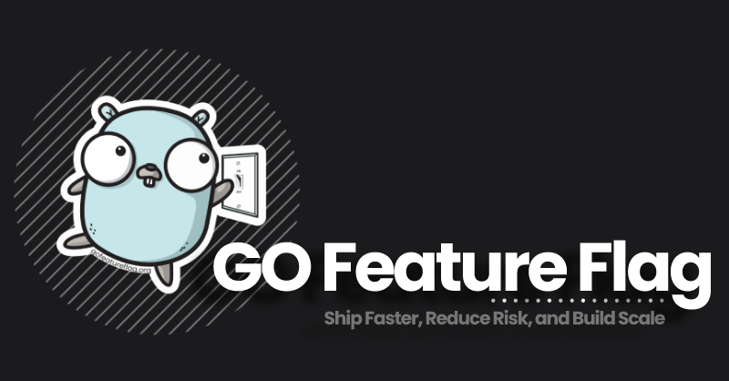](https://gofeatureflag.org/blog/2025/01/21/exporter-metadata.md)

[Product](https://gofeatureflag.org/blog/2025/01/21/exporter-metadata.md)

### [Introducing Exporter Metadata in the GO Feature Flag Provider for OpenFeature.](https://gofeatureflag.org/blog/2025/01/21/exporter-metadata.md)

[Exporter metadata in the GO Feature Flag provider for OpenFeature allows enriching evaluation events with static context data like environment or app version for improved observability and analysis.](https://gofeatureflag.org/blog/2025/01/21/exporter-metadata.md)

[Thomas Poignant · 3 min read](https://gofeatureflag.org/blog/2025/01/21/exporter-metadata.md)

[Product](https://gofeatureflag.org/blog/2024/10/20/breaking-change-java.md)

### [(Java) OpenFeature provider improve the internal cache management.](https://gofeatureflag.org/blog/2024/10/20/breaking-change-java.md)

[The Java provider has been updated to improve the internal cache management by migrating from guava cache to caffeine cache.](https://gofeatureflag.org/blog/2024/10/20/breaking-change-java.md)

[Thomas Poignant · 2 min read](https://gofeatureflag.org/blog/2024/10/20/breaking-change-java.md)

[Product](https://gofeatureflag.org/blog/2024/08/14/changes-to-golang-openfeature-integration.md)

### [Changes to golang OpenFeature Integration](https://gofeatureflag.org/blog/2024/08/14/changes-to-golang-openfeature-integration.md)

[We have released 2 new golang providers for OpenFeature, let's explain all the changes.](https://gofeatureflag.org/blog/2024/08/14/changes-to-golang-openfeature-integration.md)

[Thomas Poignant · 3 min read](https://gofeatureflag.org/blog/2024/08/14/changes-to-golang-openfeature-integration.md)

[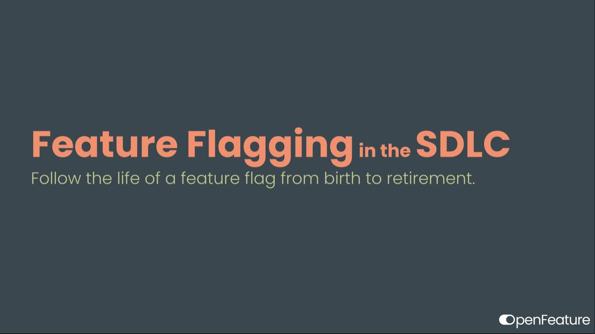](https://gofeatureflag.org/blog/2024/08/02/feature-flagging-in-the-SDLC.md)

[Engineering](https://gofeatureflag.org/blog/2024/08/02/feature-flagging-in-the-SDLC.md)

### [Feature Flagging in the SDLC](https://gofeatureflag.org/blog/2024/08/02/feature-flagging-in-the-SDLC.md)

[Feature Flagging in the Software Development Lifecycle - Follow the life of a feature flag from birth to retirement.](https://gofeatureflag.org/blog/2024/08/02/feature-flagging-in-the-SDLC.md)

[Thomas Poignant · 1 min read](https://gofeatureflag.org/blog/2024/08/02/feature-flagging-in-the-SDLC.md)

[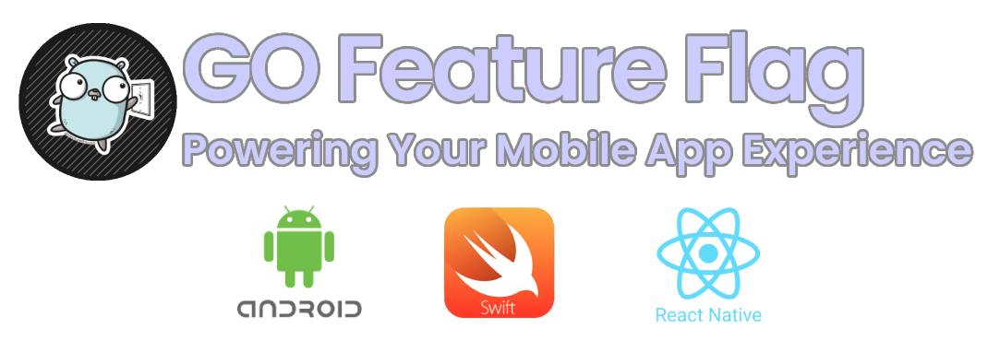](https://gofeatureflag.org/blog/2024/07/25/go-feature-flag-mobile-support.md)

[Product](https://gofeatureflag.org/blog/2024/07/25/go-feature-flag-mobile-support.md)

### [GO Feature Flag: Now Powering Your Mobile App Experience](https://gofeatureflag.org/blog/2024/07/25/go-feature-flag-mobile-support.md)

[GO Feature Flag: Now Powering Your Mobile App Experience.](https://gofeatureflag.org/blog/2024/07/25/go-feature-flag-mobile-support.md)

[Thomas Poignant · 4 min read](https://gofeatureflag.org/blog/2024/07/25/go-feature-flag-mobile-support.md)

[Product](https://gofeatureflag.org/blog/2024/03/13/ofrep.md)

### [GO Feature Flag Supports OpenFeature Remote Evaluation Protocol (OFREP)!](https://gofeatureflag.org/blog/2024/03/13/ofrep.md)

[GO Feature Flag is now one of the first flag management systems to support the Open Feature Remote Evaluation Protocol (OFREP).](https://gofeatureflag.org/blog/2024/03/13/ofrep.md)

[Thomas Poignant · 7 min read](https://gofeatureflag.org/blog/2024/03/13/ofrep.md)

[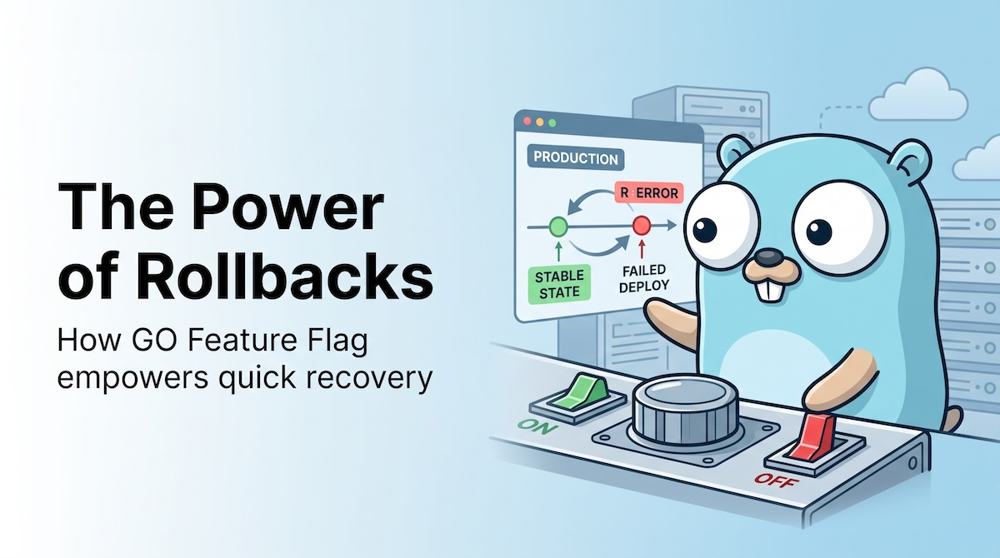](https://gofeatureflag.org/blog/2023/09/12/the-power-of-rollbacks.md)

[Engineering](https://gofeatureflag.org/blog/2023/09/12/the-power-of-rollbacks.md)

### [The Power of Rollbacks](https://gofeatureflag.org/blog/2023/09/12/the-power-of-rollbacks.md)

[🚨 Bug alert! No worries, feature flags have your back. Learn how to respond swiftly to issues without breaking a sweat](https://gofeatureflag.org/blog/2023/09/12/the-power-of-rollbacks.md)

[Thomas Poignant · 5 min read](https://gofeatureflag.org/blog/2023/09/12/the-power-of-rollbacks.md)

[Engineering](https://gofeatureflag.org/blog/2023/07/24/nodejs-tutorial.md)

### [Add Feature Flags in your Node.JS application using GO Feature Flag and Open Feature SDK](https://gofeatureflag.org/blog/2023/07/24/nodejs-tutorial.md)

[In this video, we'll walk you through the process of implementing feature flags in your Node js applications, allowing you to roll out new features gradually and control their visibility in real-time.](https://gofeatureflag.org/blog/2023/07/24/nodejs-tutorial.md)

[Thomas Poignant · 3 min read](https://gofeatureflag.org/blog/2023/07/24/nodejs-tutorial.md)

[Product](https://gofeatureflag.org/blog/2023/06/09/flag-metadata.md)

### [Enhancing Flag Configuration with Flag Metadata](https://gofeatureflag.org/blog/2023/06/09/flag-metadata.md)

[Empowering developers to attach additional information directly to flag configurations for enhanced management and code efficiency.](https://gofeatureflag.org/blog/2023/06/09/flag-metadata.md)

[Thomas Poignant · 3 min read](https://gofeatureflag.org/blog/2023/06/09/flag-metadata.md)

[Product](https://gofeatureflag.org/blog/2023/04/12/relay_proxy_api_keys.md)

### [Limiting Access to the relay proxy with API Keys](https://gofeatureflag.org/blog/2023/04/12/relay_proxy_api_keys.md)

[New API Key feature in GO Feature Flag Relay Proxy 1.7.0 allows you to restrict access to the relay proxy to only known clients.](https://gofeatureflag.org/blog/2023/04/12/relay_proxy_api_keys.md)

[Thomas Poignant · 3 min read](https://gofeatureflag.org/blog/2023/04/12/relay_proxy_api_keys.md)

[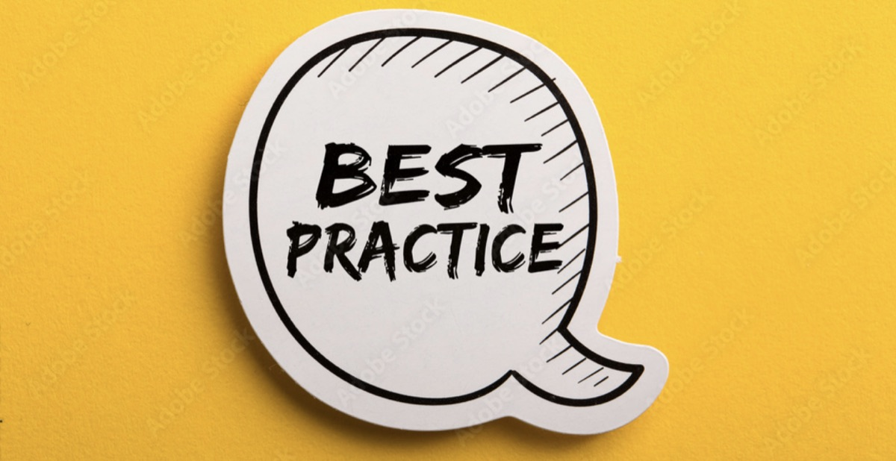](https://gofeatureflag.org/blog/feature-flag-best-practice.md)

[Engineering](https://gofeatureflag.org/blog/feature-flag-best-practice.md)

### [Feature Flag best practice](https://gofeatureflag.org/blog/feature-flag-best-practice.md)

[Discover best practices for using feature flags in software development to improve agility and reduce risk.](https://gofeatureflag.org/blog/feature-flag-best-practice.md)

[Thomas Poignant · 3 min read](https://gofeatureflag.org/blog/feature-flag-best-practice.md)

[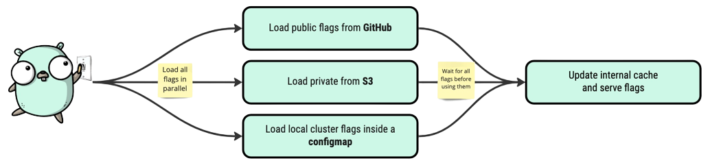](https://gofeatureflag.org/blog/2023/03/17/multiple-config-file.md)

[Product](https://gofeatureflag.org/blog/2023/03/17/multiple-config-file.md)

### [Multiple Configuration Flags for GO Feature Flag 🗄️](https://gofeatureflag.org/blog/2023/03/17/multiple-config-file.md)

[Are you tired of managing your feature flags with a single configuration flag?](https://gofeatureflag.org/blog/2023/03/17/multiple-config-file.md)

[Thomas Poignant · 3 min read](https://gofeatureflag.org/blog/2023/03/17/multiple-config-file.md)

[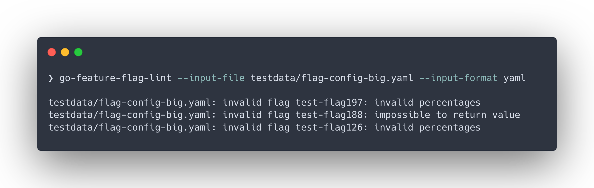](https://gofeatureflag.org/blog/2023/02/20/lint-your-feature-flags.md)

[Engineering](https://gofeatureflag.org/blog/2023/02/20/lint-your-feature-flags.md)

### [Lint your feature flag config in you CI/CD pipelines ❌ ✅](https://gofeatureflag.org/blog/2023/02/20/lint-your-feature-flags.md)

[As GO Feature Flag continues to evolve, we're excited to announce a new feature that will make it easier for our users to manage their feature flags.](https://gofeatureflag.org/blog/2023/02/20/lint-your-feature-flags.md)

[Thomas Poignant · 4 min read](https://gofeatureflag.org/blog/2023/02/20/lint-your-feature-flags.md)

[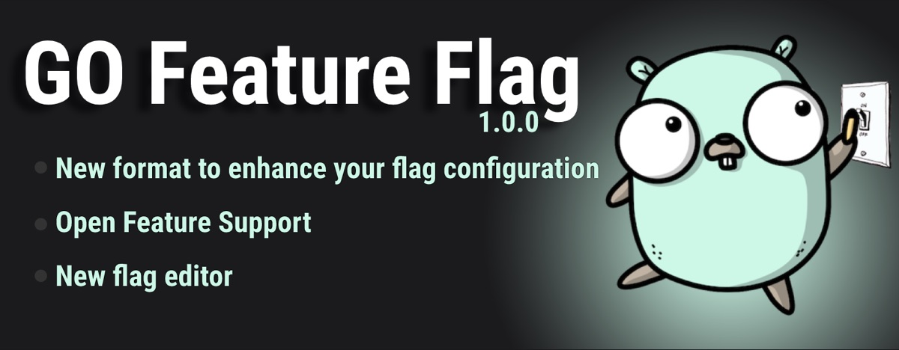](https://gofeatureflag.org/blog/2023/02/01/introducing-v1.0.0.md)

[Product](https://gofeatureflag.org/blog/2023/02/01/introducing-v1.0.0.md)

### [🚀 Announcing GO Feature Flag v1.0.0](https://gofeatureflag.org/blog/2023/02/01/introducing-v1.0.0.md)

[GO Feature Flag logo](https://gofeatureflag.org/blog/2023/02/01/introducing-v1.0.0.md)

[Thomas Poignant · 6 min read](https://gofeatureflag.org/blog/2023/02/01/introducing-v1.0.0.md)

[Community](https://gofeatureflag.org/blog/2022/07/01/feature-flags-devobs-podcast.md)

### [🔊 Feature Flags in Dev’Obs Podcast 🇫🇷](https://gofeatureflag.org/blog/2022/07/01/feature-flags-devobs-podcast.md)

[Earlier this week the super cool podcast Dev’Obs asked me to talk about feature flags, go-feature-flag and also the super nice initiative OpenFeature.](https://gofeatureflag.org/blog/2022/07/01/feature-flags-devobs-podcast.md)

[Thomas Poignant · 1 min read](https://gofeatureflag.org/blog/2022/07/01/feature-flags-devobs-podcast.md)

[Engineering](https://gofeatureflag.org/blog/automate-your-product-release-cycles-using-go-feature-flag.md)

### [Automate Your Product Release Cycles Using Go Feature Flag](https://gofeatureflag.org/blog/automate-your-product-release-cycles-using-go-feature-flag.md)

[When you build a new feature, orchestrating the actual launch schedule between the Product, Engineering, and Marketing](https://gofeatureflag.org/blog/automate-your-product-release-cycles-using-go-feature-flag.md)

[Thomas Poignant · 5 min read](https://gofeatureflag.org/blog/automate-your-product-release-cycles-using-go-feature-flag.md)

[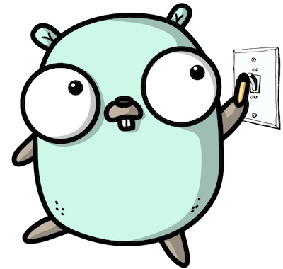](https://gofeatureflag.org/blog/introduction-blog-post.md)

[Product](https://gofeatureflag.org/blog/introduction-blog-post.md)

### [Introduction blog post](https://gofeatureflag.org/blog/introduction-blog-post.md)

[I absolutely don’t think human/manual QA gates should be involved in between the writing of code and its being live. To avoid breaking things every time and to have an early cutoff system, you should use feature flags.](https://gofeatureflag.org/blog/introduction-blog-post.md)

[Thomas Poignant · 5 min read](https://gofeatureflag.org/blog/introduction-blog-post.md)

Load more (

<!-- -->

16

<!-- -->

)
