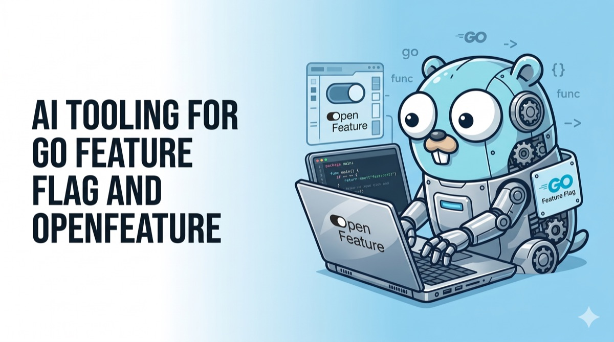

# AI Tooling for GO Feature Flag and OpenFeature

May 2, 2026 ·

<!-- -->

4 min read

[](https://github.com/thomaspoignant)

[Thomas Poignant](https://github.com/thomaspoignant)

Creator of GO Feature Flag



AI coding assistants have become a regular part of the developer workflow — writing boilerplate, suggesting configurations, explaining APIs. But when it comes to feature flags, generic AI often gets the details wrong: incorrect flag schema, outdated OpenFeature SDK patterns, or relay proxy configuration that doesn't quite match what GO Feature Flag expects.

Community members have built tools that fix this — injecting domain knowledge directly into your AI assistant so it generates accurate, idiomatic code from the start.

## Skills: Teaching your AI assistant about GO Feature Flag and OpenFeature[​](#skills-teaching-your-ai-assistant-about-go-feature-flag-and-openfeature "Direct link to Skills: Teaching your AI assistant about GO Feature Flag and OpenFeature")

Skills are bundles of domain knowledge you install into your AI assistant. Once installed, your assistant understands the specifics of GO Feature Flag and OpenFeature without you having to paste documentation or correct hallucinations.

Both skills are available from the [laurigates/claude-plugins](https://github.com/laurigates/claude-plugins) repository and are installed using the `npx playbooks` CLI.

### GO Feature Flag Skill[​](#go-feature-flag-skill "Direct link to GO Feature Flag Skill")

This skill covers the GO Feature Flag configuration format (YAML/JSON/TOML), targeting rules and operators, rollout strategies (progressive, scheduled, A/B), relay proxy configuration, and deployment patterns.

```
npx playbooks add skill laurigates/claude-plugins --skill go-feature-flag
```

After installing, your AI assistant can generate correct flag configurations, suggest appropriate rollout strategies, and help you configure the relay proxy without needing to look up the schema.

### OpenFeature Skill[​](#openfeature-skill "Direct link to OpenFeature Skill")

This skill covers the OpenFeature vendor-agnostic SDK API — initialization, client usage, evaluation context, hooks, and provider patterns across supported languages.

```
npx playbooks add skill laurigates/claude-plugins --skill openfeature
```

With this skill installed, your AI assistant understands how to wire up providers, construct evaluation context, and follow OpenFeature best practices regardless of which backend you're using.

***

## OpenFeature MCP Server: Live flag evaluation in your editor[​](#openfeature-mcp-server-live-flag-evaluation-in-your-editor "Direct link to OpenFeature MCP Server: Live flag evaluation in your editor")

The [OpenFeature MCP Server](https://openfeature.dev/docs/reference/other-technologies/mcp/) brings GO Feature Flag closer to your editor through the [Model Context Protocol](https://modelcontextprotocol.io/) — a standard that lets AI tools call external services as part of their reasoning.

It provides two capabilities:

* **SDK installation guidance** — get setup instructions for OpenFeature SDKs across languages and frameworks, directly in your AI conversation
* **Live flag evaluation** — evaluate feature flags via OFREP against a running GO Feature Flag relay proxy, without leaving your editor

### Install[​](#install "Direct link to Install")

**Via the Claude Code CLI:**

```
claude mcp add --transport stdio openfeature npx -y @openfeature/mcp
```

**Via JSON config** (compatible with Claude Code, Cursor, VS Code, and other MCP-supporting tools):

```
{

  "mcpServers": {

    "OpenFeature": {

      "command": "npx",

      "args": ["-y", "@openfeature/mcp"]

    }

  }

}
```

### Configure for live evaluation[​](#configure-for-live-evaluation "Direct link to Configure for live evaluation")

To enable flag evaluation against your relay proxy, set the following environment variables (or add them to `~/.openfeature-mcp.json`):

| Variable                         | Description                                              |
| -------------------------------- | -------------------------------------------------------- |
| `OPENFEATURE_OFREP_BASE_URL`     | Your relay proxy endpoint (e.g. `http://localhost:1031`) |
| `OPENFEATURE_OFREP_BEARER_TOKEN` | Bearer token authentication                              |
| `OPENFEATURE_OFREP_API_KEY`      | API key authentication                                   |

***

## Putting it all together[​](#putting-it-all-together "Direct link to Putting it all together")

The skills and the MCP server address different parts of the workflow. Skills improve code generation — your AI assistant produces accurate flag configurations and correct SDK usage from the first attempt. The MCP server adds runtime awareness — your assistant can evaluate flags against a live relay proxy and suggest SDK setup for the language you're working in.

Together, they close the loop: write a flag configuration, deploy it to the relay proxy, and verify its behavior, all without leaving your editor.

***

> **Note:** These tools are community contributions and are not officially maintained by the GO Feature Flag project. For issues, questions, or contributions, refer to the respective project repositories. Full install details are available in the [AI Tools documentation page](https://gofeatureflag.org/docs/tooling/ai-tools.md).

If you try these tools, share your feedback on [GitHub](https://github.com/thomaspoignant/go-feature-flag) or in the [CNCF Slack #openfeature channel](https://cloud-native.slack.com/archives/C0344AANLA1). The more people experiment with AI-assisted feature flag workflows, the better these tools will get.

**Tags:**

* [openfeature](https://gofeatureflag.org/blog/tags/openfeature)
* [ai](https://gofeatureflag.org/blog/tags/ai)
* [developer-experience](https://gofeatureflag.org/blog/tags/developer-experience)
* [community](https://gofeatureflag.org/blog/tags/community)

[Edit this page](https://github.com/thomaspoignant/go-feature-flag/tree/main/website/blog/2026-05-02-ai-tooling-go-feature-flag/index.md)
