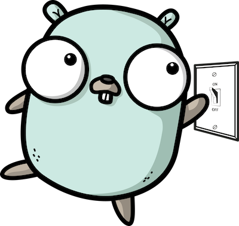

# GO Feature Flag documentation

**GO Feature Flag** is a lightweight, open-source feature flag solution with **no backend to run**.

You describe your flags in a simple configuration file, serve them with a single stateless service — the [relay proxy](https://gofeatureflag.org/docs/relay-proxy.md) — and evaluate them from your applications in <!-- -->16<!-- --> languages through [OpenFeature](https://openfeature.dev), the CNCF standard for feature flagging.

No database, no proprietary SDK, no vendor lock-in.

New to feature flags?

Read [**What are feature flags?**](https://gofeatureflag.org/product/what-are-feature-flags) for a quick primer, or [**Why GO Feature Flag?**](https://gofeatureflag.org/product/why_go_feature_flag) to see how it compares to other solutions.

## Start here[​](#start-here "Direct link to Start here")

[**](https://gofeatureflag.org/docs/getting-started.md)

### [Get started in 5 minutes](https://gofeatureflag.org/docs/getting-started.md)

[Create your first flag, start the relay proxy, and evaluate the flag from your application.](https://gofeatureflag.org/docs/getting-started.md)

[Get started**](https://gofeatureflag.org/docs/getting-started.md)

[**](https://gofeatureflag.org/docs/sdk.md)

### [Pick your SDK](https://gofeatureflag.org/docs/sdk.md)

[16 languages, client-side and server-side, all built on the OpenFeature standard.](https://gofeatureflag.org/docs/sdk.md)

[Get started**](https://gofeatureflag.org/docs/sdk.md)

## How it works[​](#how-it-works "Direct link to How it works")

**1. Describe your flags in a configuration file.** Variations are the possible values, and the rules decide who gets which one.

flags.goff.yaml

```
show-email-contact:

  variations:

    enabled: true

    disabled: false

  targeting:

    - query: company eq "monsters-inc"

      variation: enabled

  defaultRule:

    variation: disabled
```

**2. Evaluate the flag in your application** through the OpenFeature SDK. You always get a value back — the default one if anything goes wrong.

```
evalCtx := of.NewEvaluationContext("user-123", map[string]any{"company": "monsters-inc"})

showContact := client.Boolean(ctx, "show-email-contact", false, evalCtx)
```

Change the configuration file and the new behaviour is live, without redeploying or restarting your application.

info

The snippet above is in Go, but the API is the same in every language. Check the [**SDKs**](https://gofeatureflag.org/docs/sdk.md) section for the one matching yours.

## Explore the documentation[​](#explore-the-documentation "Direct link to Explore the documentation")

[**Concepts](https://gofeatureflag.org/docs/concepts/architecture.md)

[Architecture, flag evaluation, evaluation context, flag sets and the SDK paradigms.](https://gofeatureflag.org/docs/concepts/architecture.md)

[**Configure your flags](https://gofeatureflag.org/docs/configure_flag/create-flags.md)

[The flag format, targeting rules and custom bucketing to decide who gets what.](https://gofeatureflag.org/docs/configure_flag/create-flags.md)

[**Rollout strategies](https://gofeatureflag.org/docs/configure_flag/rollout-strategies.md)

[Progressive rollouts, scheduled changes, A/B testing and percentage-based releases.](https://gofeatureflag.org/docs/configure_flag/rollout-strategies.md)

[**Relay proxy](https://gofeatureflag.org/docs/relay-proxy.md)

[Configure, deploy and monitor the only component you run in your infrastructure.](https://gofeatureflag.org/docs/relay-proxy.md)

[**SDKs](https://gofeatureflag.org/docs/sdk.md)

[OpenFeature providers for 16 languages, plus the OFREP standard protocol.](https://gofeatureflag.org/docs/sdk.md)

[**Store your configuration](https://gofeatureflag.org/docs/integrations/store-flags-configuration.md)

[Keep your flags where it suits you: S3, GitHub, Kubernetes, MongoDB, PostgreSQL, Redis and more.](https://gofeatureflag.org/docs/integrations/store-flags-configuration.md)

[**Export evaluation data](https://gofeatureflag.org/docs/integrations/export-evaluation-data.md)

[Send every flag evaluation to Kafka, BigQuery, S3, OpenTelemetry, a webhook and more.](https://gofeatureflag.org/docs/integrations/export-evaluation-data.md)

[**Notify flag changes](https://gofeatureflag.org/docs/integrations/notify-flags-changes.md)

[Get alerted in Slack, Discord, Microsoft Teams or your own webhook when a flag changes.](https://gofeatureflag.org/docs/integrations/notify-flags-changes.md)

[**Tracking](https://gofeatureflag.org/docs/tracking/flag-usage-tracking.md)

[Track how your flags are used and measure the impact of your experiments.](https://gofeatureflag.org/docs/tracking/flag-usage-tracking.md)

[**Tools](https://gofeatureflag.org/docs/tooling/cli.md)

[CLI, linter, editor autocomplete and AI tooling to work with your flag configuration.](https://gofeatureflag.org/docs/tooling/cli.md)

[**Contributing](https://gofeatureflag.org/docs/contributing.md)

[GO Feature Flag is open source and community driven, here is how to help.](https://gofeatureflag.org/docs/contributing.md)

Writing a Go service and prefer not to run the relay proxy? GO Feature Flag is also available as a [Go module](https://gofeatureflag.org/docs/go_module/getting-started.md) you can embed directly into your application.

## Need help?[​](#need-help "Direct link to Need help?")

* Ask your question in the [**community Slack**](https://gofeatureflag.org/slack).
* Found a bug or have an idea? [**Open an issue**](https://github.com/thomaspoignant/go-feature-flag/issues/new/choose).
* Curious about what shipped? Read the [**release notes**](https://github.com/thomaspoignant/go-feature-flag/releases).
