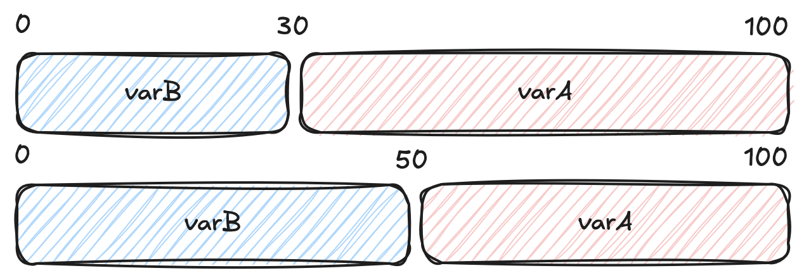
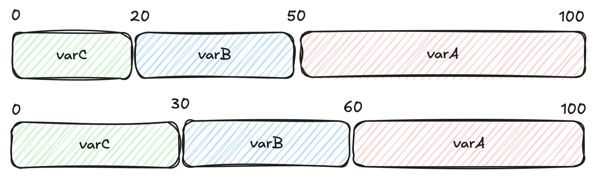

# 💯 Percentage rollout

## Overview[​](#overview "Direct link to Overview")

A percentage rollout refers to a gradual release of a new feature to a subset of users. Instead of making the feature available to everyone at once, you want to have only a subset of your customers to see the new feature.

## Define a percentage rollout[​](#define-a-percentage-rollout "Direct link to Define a percentage rollout")

In GO Feature Flag, you can define a percentage rollout by setting the percentage of users that will see the new feature. You can define the percentage in the flag configuration, and it works for the default rule or any other targeting rule you define.

The expected format is a map where the **key is the variation name** and the **value is the percentage** of users that will see this variation.

You can have as many variations as you want in the percentages, and you can define the percentage of users that will see each variation.

note

If the sum of your percentages is not equal to 100 this is not a problem, we are computing the affectation as fractional numbers.

***example**: if you have 2 variations and you set `variation1: 10` and `variation2: 50` it will be equivalent to `variation1: 10/60` and `variation2: 50/60`.*

## How percentage rollout works?[​](#how-percentage-rollout-works "Direct link to How percentage rollout works?")

GO Feature Flag uses a deterministic hashing algorithm to ensure consistent user assignment to variations. Here's how it works:

### Hash computation[​](#hash-computation "Direct link to Hash computation")

For each evaluation, GO Feature Flag computes a hash based on the **targeting key** (also called bucketing key) and the **flag name**:

```
hash = hash(targetingKey + flagName) % maxPercentage
```

This hash produces a value between `0` and `maxPercentage` (which is the sum of all percentages). The hash function ensures that the same user (with the same targeting key) will always get the same hash value for a given flag, providing consistent assignment.

### Bucket assignment[​](#bucket-assignment "Direct link to Bucket assignment")

All variations that are part of the percentage rollout are sorted by **reverse alphabetical**. This ensures consistent bucket assignment across evaluations.

For example, if you have the following percentages:

```
percentage:

  - varC: 20

  - varB: 30

  - varA: 50
```

After sorting by inverse alphabetical order, the buckets are assigned as follows:

* **0 to 20**: assigned to `varC`
* **20 to 50**: assigned to `varB`
* **50 to 100**: assigned to `varA`

The hash value determines which bucket the user falls into, and thus which variation they receive.

Since it is pure hash based, GO Feature Flag will always assign the evaluation context to the same bucket even if your evaluation is done on a different server or if you restart your relay-proxy.

### Impact of changing percentages[​](#impact-of-changing-percentages "Direct link to Impact of changing percentages")

When you have two variations, adjusting the percentages simply increases or decreases the number of users assigned to each variation.<br /><!-- -->This allows you to gradually roll out a feature in a predictable and straightforward way.



But if you have **more than 2 variations**, this can have an impact on how your bucketing works.<br /><!-- -->When you change the percentage configuration, **all buckets are recalculated**, which means users may be reassigned to different variations. This happens because the bucket boundaries shift based on the new percentages.

For example, if you change the configuration to:

```
percentage:

  - varC: 30

  - varB: 30

  - varA: 40
```

The new bucket assignments become:

* **0 to 30**: assigned to `varC`
* **30 to 60**: assigned to `varB`
* **60 to 100**: assigned to `varA`

As you can see in the diagram below, changing percentages shifts the bucket boundaries, which can move users from one variation to another:



info

The deterministic hashing ensures that the same user will always get the same variation for a given configuration. However, when you change percentages, the bucket boundaries change, which may cause some users to be reassigned to different variations.

## Examples[​](#examples "Direct link to Examples")

### Define in the default rule[​](#define-in-the-default-rule "Direct link to Define in the default rule")

In this example `99%` of the users will see the `disabled` variation and `1%` will see the `enabled` variation.

flag-config.goff.yaml

```
percentage-flag-1:

  variations:

    disabled: false

    enabled: true

  defaultRule:

    percentage:

      disabled: 99

      enabled: 1
```

### Define in a targeting rule[​](#define-in-a-targeting-rule "Direct link to Define in a targeting rule")

In this second example, `50%` of the users that are `admin` will see the `disabled` variation and `50%` will see the `enabled` variation. Non admin users will see the `disabled` variation.

flag-config.goff.yaml

```
percentage-flag-1:

  variations:

    disabled: false

    enabled: true

  targeting:

    - query: admin eq true

      percentage:

        disabled: 50

        enabled: 50

  defaultRule:

    variation: disabled
```

## 🐥 Canary releases[​](#-canary-releases "Direct link to 🐥 Canary releases")

Percentage rollout are also known as **canary releases**, where you release a new feature to a small subset of users before rolling it out to everyone.
