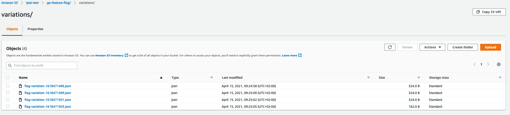

# AWS S3

## Overview[​](#overview "Direct link to Overview")

<!-- -->

The S3 exporter will collect the data and create a new file in a specific folder everytime we send the data.

<!-- -->

Everytime the `FlushInterval` or `MaxEventInMemory` is reached a new file will be added to <!-- -->AWS S3<!-- -->.

info

If for some reason the <!-- -->AWS S3<!-- --> upload fails, we will keep the data in memory and retry to add the next time we reach `FlushInterval` or `MaxEventInMemory`.



## Configure the relay proxy[​](#configure-the-relay-proxy "Direct link to Configure the relay proxy")

To configure your relay proxy to use the <!-- -->AWS S3<!-- --> exporter, you need to add the following configuration to your relay proxy configuration file:

goff-proxy.yaml

```
# ...

exporters:

  - kind: s3

    bucket: evaluation-data-bucket

# ...
```

info

If you are using the S3 exporter, the easiest way to provide credentials is to set environment variables. It will be used by GO Feature Flag to identify to your S3 bucket.

```
export AWS_SECRET_ACCESS_KEY=xxxx

export AWS_ACCESS_KEY_ID=xxx

export AWS_DEFAULT_REGION=eu-west-1
```

| Field name                | Mandatory | Type   | Default                                                                                                                            | Description                                                                                                                                                                                                                                                                                                                                                                             |
| ------------------------- | --------- | ------ | ---------------------------------------------------------------------------------------------------------------------------------- | --------------------------------------------------------------------------------------------------------------------------------------------------------------------------------------------------------------------------------------------------------------------------------------------------------------------------------------------------------------------------------------- |
| `kind`                    | **        | string | **none**                                                                                                                           | **(mandatory)** Value should be **`s3`**.<br />*This field is mandatory and describes which retriever you are using.*                                                                                                                                                                                                                                                                   |
| `bucket`                  | **        | string | **none**                                                                                                                           | **(mandatory)** Name of your S3 Bucket.                                                                                                                                                                                                                                                                                                                                                 |
| `flushInterval`           | **        | int    | `60000`                                                                                                                            | The interval in millisecond between 2 calls to the webhook *(if the `maxEventInMemory` is reached before the flushInterval we will call the exporter before)*.                                                                                                                                                                                                                          |
| `maxEventInMemory`        | **        | int    | `100000`                                                                                                                           | If we hit that limit we will call the exporter.                                                                                                                                                                                                                                                                                                                                         |
| `format`                  | **        | string | `JSON`                                                                                                                             | Format is the output format you want in your exported file. Available format: `JSON`, `CSV`, `Parquet`.                                                                                                                                                                                                                                                                                 |
| `filename`                | **        | string | `flag-variation-{{ .Hostname}}-{{ .Timestamp}}.{{ .Format}}`                                                                       | You can use a config template to define the name of your exported files. Available replacements are `{{ .Hostname}}`, `{{ .Timestamp}}` and `{{ .Format}`                                                                                                                                                                                                                               |
| `csvTemplate`             | **        | string | `{{ .Kind}};{{ .ContextKind}};{{ .UserKey}};{{ .CreationDate}};{{ .Key}};{{ .Variation}};{{ .Value}};{{ .Default}};{{ .Source}}\n` | CsvTemplate is used if your output format is CSV.<br />This field will be ignored if you are using format other than CSV.<br />You can decide which fields you want in your CSV line with a go-template syntax, please check [`exporter/feature_event.go`](https://github.com/thomaspoignant/go-feature-flag/blob/main/exporter/feature_event.go) to see what are the fields available. |
| `path`                    | **        | string | **bucket root level**                                                                                                              | The location of the directory in S3.                                                                                                                                                                                                                                                                                                                                                    |
| `parquetCompressionCodec` | **        | string | `SNAPPY`                                                                                                                           | ParquetCompressionCodec is the parquet compression codec for better space efficiency. [Available options](https://github.com/apache/parquet-format/blob/master/Compression.md)                                                                                                                                                                                                          |

### Compatibility with S3-Compatible Solutions[​](#compatibility-with-s3-compatible-solutions "Direct link to Compatibility with S3-Compatible Solutions")

The S3 exporter also works with S3-compatible object stores such as **MinIO**, Ceph or Garage: keep `kind: s3` and point the AWS SDK at your server with `AWS_ENDPOINT_URL_S3`.

info

Read the [**MinIO** page](https://gofeatureflag.org/docs/integrations/export-evaluation-data/minio.md) for the full setup, including the bucket addressing gotcha you will hit if your endpoint is a hostname rather than an IP address.

## Configure the GO Module[​](#configure-the-go-module "Direct link to Configure the GO Module")

To configure your GO module to use the <!-- -->AWS S3<!-- --> exporter, you need to add the following configuration to your `ffclient.Config{}` object:

info

The [**S3 Exporter v2**](https://pkg.go.dev/github.com/thomaspoignant/go-feature-flag/exporter/s3exporterv2) will use the [`aws-sdk-go-v2`](https://github.com/aws/aws-sdk-go-v2) to store your evaluation data in an S3 bucket.

The [**S3 Retriever v1**](https://pkg.go.dev/github.com/thomaspoignant/go-feature-flag/exporter/s3exporter) will use the deprecated [`aws-sdk-go`](https://github.com/aws/aws-sdk-go) to access your flag in an S3 bucket.

[AWS has announce end-of-support for AWS SDK for Go v1](https://aws.amazon.com/blogs/developer/announcing-end-of-support-for-aws-sdk-for-go-v1-on-july-31-2025/), and it's recommended to migrate from S3 Retriever v1 to v2.

example.go

```
awsConfig, _ := config.LoadDefaultConfig(context.Background())

config := ffclient.Config{

    // ...

   DataExporter: ffclient.DataExporter{

        // ...

        Exporter: &s3exporterv2.Exporter{

            Format: "csv",

            FileName: "flag-variation-{{ .Hostname}}-{{ .Timestamp}}.{{ .Format}}",

            CsvTemplate: "{{ .Kind}};{{ .ContextKind}};{{ .UserKey}};{{ .CreationDate}};{{ .Key}};{{ .Variation}};{{ .Value}};{{ .Default}};{{ .Source}}\n",

            Bucket:    "my-bucket",

            S3Path:    "/go-feature-flag/variations/",

            Filename:  "flag-variation-{{ .Timestamp}}.{{ .Format}}",

            AwsConfig: &awsConfig,

        },

    },

    // ...

}

err := ffclient.Init(config)

defer ffclient.Close()
```

| Field name                | Mandatory | Default                                                                                                                            | Description                                                                                                                                                                                                                                                                                                                                                                             |
| ------------------------- | --------- | ---------------------------------------------------------------------------------------------------------------------------------- | --------------------------------------------------------------------------------------------------------------------------------------------------------------------------------------------------------------------------------------------------------------------------------------------------------------------------------------------------------------------------------------- |
| `Bucket`                  | **        | **none**                                                                                                                           | Name of your S3 Bucket.                                                                                                                                                                                                                                                                                                                                                                 |
| `AwsConfig`               | **        | `config.LoadDefaultConfig()`                                                                                                       | An instance of `aws.Config` that configures your access to AWS *(see [this documentation for more info](https://aws.github.io/aws-sdk-go-v2/docs/configuring-sdk/))*.<br />If not set, `config.LoadDefaultConfig()` is called for you, which reads the standard AWS environment variables and shared config files.                                                                      |
| `FlushInterval`           | **        | 60000\`                                                                                                                            | The interval in millisecond between 2 calls to the webhook *(if the `maxEventInMemory` is reached before the flushInterval we will call the exporter before)*.                                                                                                                                                                                                                          |
| `MaxEventInMemory`        | **        | `100000`                                                                                                                           | If we hit that limit we will call the exporter.                                                                                                                                                                                                                                                                                                                                         |
| `Format`                  | **        | `JSON`                                                                                                                             | Format is the output format you want in your exported file. Available format: `JSON`, `CSV`, `Parquet`.                                                                                                                                                                                                                                                                                 |
| `Filename`                | **        | `flag-variation-{{ .Hostname}}-{{ .Timestamp}}.{{ .Format}}`                                                                       | You can use a config template to define the name of your exported files. Available replacements are `{{ .Hostname}}`, `{{ .Timestamp}}` and `{{ .Format}`                                                                                                                                                                                                                               |
| `CsvTemplate`             | **        | `{{ .Kind}};{{ .ContextKind}};{{ .UserKey}};{{ .CreationDate}};{{ .Key}};{{ .Variation}};{{ .Value}};{{ .Default}};{{ .Source}}\n` | CsvTemplate is used if your output format is CSV.<br />This field will be ignored if you are using format other than CSV.<br />You can decide which fields you want in your CSV line with a go-template syntax, please check [`exporter/feature_event.go`](https://github.com/thomaspoignant/go-feature-flag/blob/main/exporter/feature_event.go) to see what are the fields available. |
| `Path`                    | **        | **bucket root level**                                                                                                              | The location of the directory in S3.                                                                                                                                                                                                                                                                                                                                                    |
| `ParquetCompressionCodec` | **        | `SNAPPY`                                                                                                                           | ParquetCompressionCodec is the parquet compression codec for better space efficiency. [Available options](https://github.com/apache/parquet-format/blob/master/Compression.md)                                                                                                                                                                                                          |
