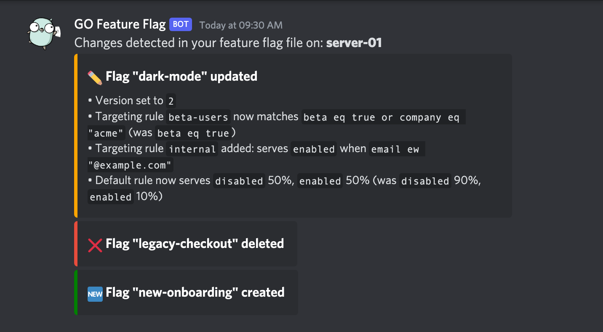
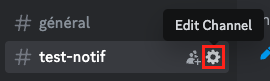
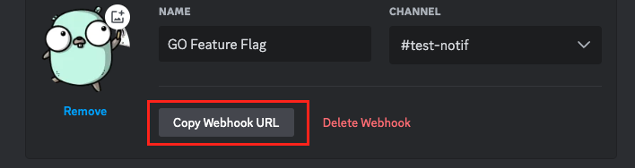

# Discord

## Overview[​](#overview "Direct link to Overview")

<!-- -->

Send notifications to a Discord channel.

<!-- -->

## About <!-- -->Discord<!-- --> Notifier[​](#about-notifiername-notifier "Direct link to about-notifiername-notifier")

The discord notifier allows to get notified on your favorite discord channel when an instance of `go-feature-flag` is detecting changes in the configuration of your flags.



Each notification lists the flags that were created, updated or deleted. For an updated flag, every change is described as a short sentence, for example:

```
✏️ Flag "dark-mode" updated

• Version set to `2`

• Targeting rule `beta-users` now matches `beta eq true or company eq "acme"` (was `beta eq true`)

• Targeting rule `internal` added: serves `enabled` when `email ew "@example.com"`

• Default rule now serves `disabled` 50%, `enabled` 50% (was `disabled` 90%, `enabled` 10%)
```

A flag shows at most 50 changes, and a last line counts the changes left out. Discord limits the size of a message, so when many flags change at once the longest lists are shortened first. If more than 10 flags change, the message shows the first 9 and asks you to check the logs for the rest.

## Configure Discord Notifications[​](#configure-discord-notifications "Direct link to Configure Discord Notifications")

1. Connect to your discord account and go on the channel where you want to send the notifications.
2. Go on the settings menu of your channel.



3. Under your channel’s settings, go to the "Integrations" section and create a new webhook. To create it, please follow the [official documentation](https://support.discord.com/hc/en-us/articles/228383668-Intro-to-Webhooks).
4. Copy the webhook URL



5. Now you can configure your notifier

## Configure the relay proxy[​](#configure-the-relay-proxy "Direct link to Configure the relay proxy")

To configure your relay proxy to use the <!-- -->Discord<!-- --> notifier, you need to add the following configuration to your relay proxy configuration file:

goff-proxy.yaml

```
# ...

notifier:

  - kind: discord

    webhookUrl: "https://discord.com/api/webhooks/yyyy/xxxxxxx"

# ...
```

| Field name   | Mandatory | Type   | Default  | Description                                                                                               |
| ------------ | --------- | ------ | -------- | --------------------------------------------------------------------------------------------------------- |
| `kind`       | **        | string | **none** | **Value should be `discord`**.<br />*This field is mandatory and describe which retriever you are using.* |
| `webhookUrl` | **        | string | **none** | The complete URL of your incoming webhook configured in Discord.                                          |

## Configure the GO Module[​](#configure-the-go-module "Direct link to Configure the GO Module")

To configure your GO module to use the <!-- -->Discord<!-- --> notifier, you need to add the following configuration to your `ffclient.Config{}` object:

example.go

```
err := ffclient.Init(ffclient.Config

{

    // ...

    Notifiers: []notifier.Notifier{

        &discordnotifier.Notifier{

            DiscordWebhookURL: "https://discord.com/api/webhooks/yyyy/xxxxxxx",

        },

    },

})

defer ffclient.Close()
```

| **Field**           | **Mandatory** | **Description**                           |
| ------------------- | ------------- | ----------------------------------------- |
| `DiscordWebhookURL` | **            | The complete URL of your discord webhook. |
