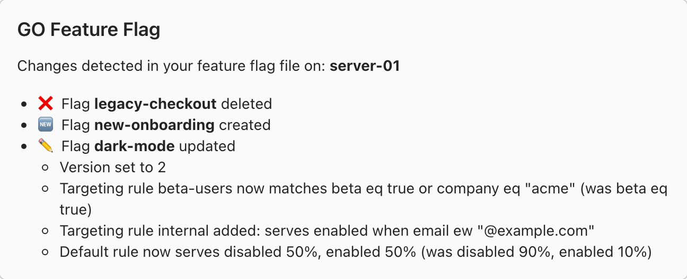

# Microsoft Teams

## Overview[​](#overview "Direct link to Overview")

<!-- -->

The microsoft teams notifier allows to get notified on your favorite microsoft teams channel when an instance of GO Feature FLag is detecting changes in the configuration of your flags.

<!-- -->

## About <!-- -->Microsoft Teams<!-- --> Notifier[​](#about-notifiername-notifier "Direct link to about-notifiername-notifier")



Each notification lists the flags that were created, updated or deleted. For an updated flag, every change is described as a short sentence, for example:

```
✏️ Flag dark-mode updated

  * Version set to 2

  * Targeting rule beta-users now matches beta eq true or company eq "acme" (was beta eq true)

  * Targeting rule internal added: serves enabled when email ew "@example.com"

  * Default rule now serves disabled 50%, enabled 50% (was disabled 90%, enabled 10%)
```

Microsoft Teams cards cannot display inline code, so names and values are shown as plain text. A flag shows at most 50 changes, and a last line counts the changes left out.

## Configure Microsoft Teams Notification[​](#configure-microsoft-teams-notification "Direct link to Configure Microsoft Teams Notification")

1. First create a Webhook in the channel you want to send notifications to.
   <br />
   *Need a hand?* [Click here to see how it's done](https://support.microsoft.com/en-us/office/create-incoming-webhooks-with-workflows-for-microsoft-teams-8ae491c7-0394-4861-ba59-055e33f75498)
2. Copy the webhook URL
3. Now you can configure your notifier

## Configure the relay proxy[​](#configure-the-relay-proxy "Direct link to Configure the relay proxy")

To configure your relay proxy to use the <!-- -->Microsoft Teams<!-- --> notifier, you need to add the following configuration to your relay proxy configuration file:

goff-proxy.yaml

```
# ...

notifiers:

  - kind: microsoftteams

    webhookUrl: "https://xxx.xxx/..."

# ...
```

| Field name   | Mandatory | Type   | Default  | Description                                                                                                      |
| ------------ | --------- | ------ | -------- | ---------------------------------------------------------------------------------------------------------------- |
| `kind`       | **        | string | **none** | **Value should be `microsoftteams`**.<br />*This field is mandatory and describes which notifier you are using.* |
| `webhookUrl` | **        | string | **none** | The complete URL of your incoming webhook configured in Microsoft Teams.                                         |

## Configure the GO Module[​](#configure-the-go-module "Direct link to Configure the GO Module")

To configure your GO module to use the <!-- -->Microsoft Teams<!-- --> notifier, you need to add the following configuration to your `ffclient.Config{}` object:

example.go

```
err := ffclient.Init(ffclient.Config

{

    // ...

    Notifiers: []notifier.Notifier{

        &microsoftteamsnotifier.Notifier{

            MicrosoftTeamsWebhookURL: "https://xxx.xxx/..."

        },

    },

})

defer ffclient.Close()
```

| **Field**                  | **Mandatory** | **Description**                                   |
| -------------------------- | ------------- | ------------------------------------------------- |
| `MicrosoftTeamsWebhookURL` | **            | The complete URL of your Microsoft Teams webhook. |
