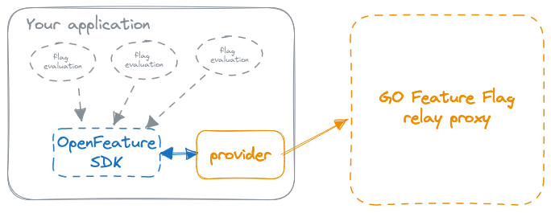

# ↔️ Relay proxy

## Overview[​](#overview "Direct link to Overview")

The GO Feature Flag Relay Proxy serves as the **backend** for your feature flag solution, housing all the necessary logic for feature flag management.

## About the relay-proxy[​](#about-the-relay-proxy "Direct link to About the relay-proxy")

It provides APIs to enable remote access to the GO Feature Flag system. While you have the option to interact directly with these APIs, it is recommended to use the **Openfeature SDK** and the appropriate **provider** for your programming language for a seamless experience.

The relay proxy is designed to be **simple, lightweight, and stateless**. It operates without the need for any databases or complex systems, as it loads feature flag configuration files from a specified location and stores them in memory. Periodic polling ensures the proxy stays up-to-date with any changes in the configuration.

This straightforward setup makes installation and usage incredibly easy and hassle-free.

The `relay-proxy` is the only component you have to run in your infrastructure to use GO Feature Flag with the different SDKs.

info

If you are using the GO Module only you don't need the relay-proxy.

The relay-proxy is an API layer on top of the GO Module, so it has the same logic inside.
