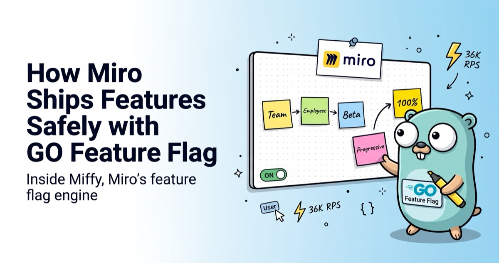
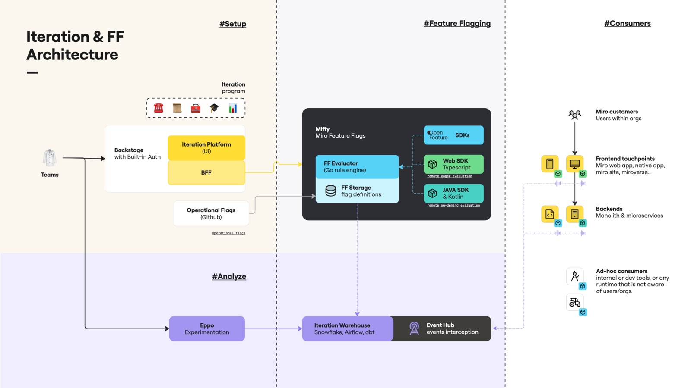

:::info A note from GO Feature Flag

This post was written with **Carlos Roberto Silveira Junior**, Staff Software Engineer on Frontend DevX at [Miro](https://miro.com/).
It is based on the Miro engineering article [Miro Feature Flags (Miffy): an architectural overview](https://miro.com/articles/engineering/miro-feature-flags-miffy-architectural-overview/), shared here with Miro's permission.
If you want the full technical deep dive, start there.

:::

Miro is a visual workspace used by teams all over the world, which means every change they ship lands in front of a lot of users at once.
To keep that safe, Miro separates **deploying code** from **releasing a feature**: code goes to production dark, and turning it on is a separate, controlled decision that can be reversed without a code rollback.

Miro calls this practice **Iteration**, and the engine that powers it is **Miffy**, Miro's feature flag engine.
Miffy's evaluator, the piece that answers _"what should this user see?"_ on every request, is built on GO Feature Flag.

<!-- truncate -->

## Why GO Feature Flag

The evaluator sits on a hot path. Backend services call it over gRPC, web clients reach it over HTTP, and it runs at **~36K requests per second** on Miro's current baseline.
The engine behind it has to be fast, deterministic and easy to evolve.

In Miro's words: _"go-feature-flag gives us an evaluation engine we can run, tune, and extend ourselves."_
Two capabilities mattered most: clients can use flags from the very first moments of the Miro app's loading sequence, and the team has direct control over cost, latency and behavior on the hot path.

Their alternatives analysis comes down to three points:

- **OpenFeature-native, no vendor lock-in.** GO Feature Flag is a first-class [OpenFeature](https://openfeature.dev) provider, so Miro's SDKs speak a vendor-neutral contract, and the engine could be swapped later without rewriting consumers.
- **Eager client-side evaluation.** Web and native SDKs receive a pre-resolved snapshot from the server, so initialization is effectively free and experiments can run during application bootstrap.
- **In-house control over the hot path.** Because GO Feature Flag is an open-source Go module, Miro extends the relay proxy behavior directly (custom endpoints, gRPC, metrics, polling strategy) and evolves it on its own schedule.

That last point is the one we like the most as maintainers.
GO Feature Flag was designed to be a building block you run in your own infrastructure, and Miro shows what that looks like at scale: an engine that a platform team can own end to end.

## The architecture in one look

_Miro's Iteration architecture. Diagram © Miro, reproduced with permission._

Miro splits Iteration into three layers, each one resting on the one below.

**The Iteration Platform (management).**
Engineers work in a UI built on [Backstage](https://backstage.io/).
They define _Ideas_, the workflows that roll them out, segments, bundles and kill switches.
A backend service, the Iteration Manager, validates every change, keeps an audit log and persists the definitions.

**Miffy (evaluation and distribution).**
This is where GO Feature Flag lives.
The Feature Flag Storage is the global source of truth: it translates what engineers defined in the platform into a configuration the evaluator can execute, _expressed as GO Feature Flag rules_.
The evaluator, built on the GO Feature Flag library, resolves flags in real time for backends and web clients.
On top of it, Miro ships OpenFeature, Web/TypeScript and Java/Kotlin SDKs that cache evaluations, propagate per-request overrides for automated tests and QA, and degrade gracefully if the evaluator is unreachable.
Operational flags managed in GitHub flow into the same storage.

**The data pipeline (insights).**
Every evaluation emits an _experimentation-viewed_ event.
Those events go through an event hub into a warehouse (Snowflake, Airflow, dbt) and into [Eppo](https://www.geteppo.com/), where teams compare a feature against a control group in near real time.
This is what turns a rollout into an experiment: every flag doubles as a measurement.

## From idea to archive

The interesting part of Miro's setup is not only the engine, it is the discipline around it.
Every flag follows the same lifecycle.

### The Golden Path

By default, a feature follows Miro's **Golden Path**, a multi-stage rollout where exposure grows only as confidence does:

1. **Team & Org Unit**: the immediate development team turns it on first, to surface functional bugs early.
2. **Employees**: the rollout expands to all Miro employees, who dogfood the feature against real-world usage.
3. **Opt-in Beta**: external users who chose to take part in the beta get access.
4. **Progressive Expansion**: exposure widens to larger and larger cohorts while the team watches performance and behavior.
5. **General Release**: once the safety and performance signals in Eppo look good, the feature goes to 100% of users.

The exact stages and pace depend on the feature, but the default keeps the blast radius of a bad change small at every step.

### Bundles and kill switches

Large initiatives rarely fit in one flag.
Miro groups related features into **bundles**: a parent flag that controls several features owned by different teams, so they reach the same cohorts at the same time.
If something misbehaves, turning off the bundle (or a **kill switch**) disables the whole initiative globally, with no code rollback.

### The life of one flag

Here is what a flag's life looks like, end to end:

- An engineer creates an Idea in the Iteration Platform. The first version of its workflow is a placeholder: **off for everyone**. Publishing it sends the translated GO Feature Flag rules through the storage to the evaluator.
- The code calls the SDK. As soon as the flag is evaluated, events start flowing and the Idea moves from _Ready_ to _Active_.
- A new version targets a beta segment. Users in that segment get the feature, and the results for that cohort show up in Snowflake and Eppo.
- The workflow moves along the Golden Path until it reaches **100%**. The team records the results (or links the Eppo analysis) in the Idea.

### Cleanup, cooldown, archive

A flag at 100% is not finished. The engineer removes the conditional and the SDK call from the code.
Then comes a **cooldown**: the platform watches for traffic and only archives the flag once nothing evaluates it anymore.
This matters most for client-side flags, where older versions of the app can keep asking for a flag long after the code that used it has been deleted.
Once archived, the flag disappears from the evaluator and the storage, and only remains as a historical record.

## Going further

Miro's original article goes much deeper into how they extended the evaluator beyond stock GO Feature Flag rules: **parent evaluation** to model bundles and kill switches, **externalized segments** holding hundreds of thousands of organizations without bloating the flag configuration, and **delta evaluation** to send clients only what changed.
If you run GO Feature Flag at scale, [it is worth the read](https://miro.com/articles/engineering/miro-feature-flags-miffy-architectural-overview/).

A big thank you to Carlos and to the Miro team behind Miffy, including Catalin Ciubotaru, Ivan Kuzyshyn, Olga Kosyreva and Oussama Zaki, for sharing their story and for trusting GO Feature Flag at the heart of how Miro ships. ❤️

Using GO Feature Flag in production and want to tell your story? Come say hi on [Slack](https://gofeatureflag.org/slack), we would love to feature you on the blog.
