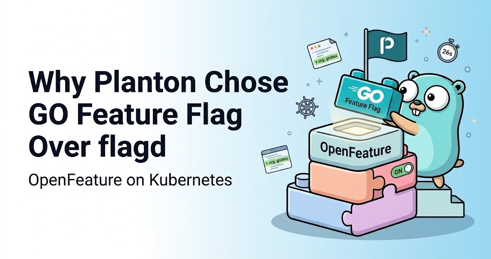

<head>
  <link
    rel="canonical"
    href="https://planton.ai/blog/feature-flags-opentelemetry-moment"
  />
</head>

:::info A note from GO Feature Flag

We are happy to welcome **Swarup Donepudi**, founder of [Planton](https://planton.ai), as a guest contributor to the GO Feature Flag blog.

Below, Swarup explains how Planton went from calling feature flags overhead to running GO Feature Flag next to its control plane in every environment: why they coded against OpenFeature, why they picked GO Feature Flag over flagd, and the surprises they hit on the way.

:::

## A Year Ago, I Called It Overhead

About a year ago, I was reviewing a plan for a part of Planton that nobody was using yet. My only feedback was this: "This system is not in production yet, so we don't need to plan for any type of feature flagging. Because at this point, I consider that as a complete overhead."

And at that moment, I think I was right. When nobody is using a system, you simply change it. There is nothing to protect.

{/* truncate */}

We have built an AI assistant into Planton, the Planton Assistant, and along with it, automations that let organizations hand their workflows to AI agents, so the agents execute them automatically based on external triggers. Based on some internal feedback, we decided it is not ready yet, and we have not released it to any organization.

As we were getting ready to go to market, the first thing that started to bother me was the fact that the Planton Assistant is scattered across the product, and it was not functional at the moment. So I needed to disable the Assistant. But when I thought about it, this is going to be common from here on. We build stuff that we don't want to enable in production yet, and only getting things out via releases is not practical. In a lot of cases, we want to enable a feature for certain organizations first.

So this is the first time we built a feature that requires a careful, slow rollout, and we wanted to have more control.

To be honest, I had never used a feature flagging system and instrumented it in a product. I didn't know what the architectural consequences were. I didn't know what I didn't know.

> **Tip:** Feature flags are overhead until the day real users arrive. From that day, a release is no longer a safe way to hold unfinished work back. If you are about to put your first unfinished feature in front of customers, that is the day to decide how you will switch things on and off, not after.

## The If-Else Phase

We initially implemented it using `if-else` conditions, which is basically the in-house way. And then we started noticing that the code is starting to get all messed up.

Here is what that looked like. The Assistant had one switch for the whole deployment, and the only signal was whether its configuration existed or not. The comment in our own code said it plainly: "Configuration presence IS the capability switch -- there is deliberately no separate enabled flag and no per-organization gating." Then, for the desktop app, which can run without an account, we had a second, private knob: a rollout percentage that decided which devices got the hosted Assistant.

So we had two mechanisms with two meanings, and neither could answer the one question I actually had: can I turn this on for this one organization? And every new place the Assistant showed up meant one more check, written a little differently each time.

That is when it clicked for me. We already had a feature flag system. It was just a bad one. There was no single place to see who has what, no owner, no expiry date, and no clean way to delete it once the feature is done.

So why did we end up there in the first place? Looking back, I think it was the lack of experience, and the development overhead. We were the ones writing all the code, so bringing in a purpose-built feature flagging system seemed like more work, not less. So we just resorted to doing it via fields in our configuration.

That is no longer true. We no longer write all the code ourselves; coding agents do a lot of it now. Once that happened, it made sense to actually go with a purpose-built system.

And it was not just the coding agents. When I look at it now, a few things came together at the same time. Coding agents made the instrumentation cheap. OpenFeature meant I would not be wiring a vendor into my product. Open-source engines meant we could run the flag system on our own infrastructure without adding any cost. And Planton made deploying that open-source software onto Kubernetes a simple thing for us. All these factors together played a crucial role in choosing to go with a proper feature flagging system.

So I wanted to understand what the options are.

> **Tip:** The moment you write your second hand-rolled switch, stop. You already have a feature flag system, just a bad one. And if you skipped a proper one because instrumenting it felt like too much work, do that math again. With coding agents, that work is now the cheap part.

## Why a Whole System for One Feature?

All we wanted to do was a gradual rollout of one single feature. So it is a fair question: why build a whole system for that?

The answer is that the Assistant is not going to be the last one. Once we have a good feature flag system in place, it becomes much easier for us to build more and more features and gradually roll them out, to provide a more optimal end-user experience. Shipping code and releasing a feature become two different things. We can merge and deploy every day, and decide separately who sees what, and when.

The first thing I learned while reading up is that "feature flag" means several different things. Pete Hodgson's article on Martin Fowler's site, ["Feature Toggles"](https://martinfowler.com/articles/feature-toggles.html), describes four kinds: release, experiment, ops and permission toggles. We built only the first kind, release flags. Which plan a customer is on is a permission, and for us that is an entitlement, a different system with different rules. If a feature eventually becomes part of a paid plan, its release flag retires and an entitlement takes over.

Then we wrote down one rule: a release flag may hide something new from organizations it is not ready for, with an expiry date and a retirement path. It never chooses between an old and a new implementation. The moment a flag starts choosing between two implementations, you are maintaining both, forever.

> **Tip:** Before you write your first flag, write down what a flag is allowed to be. And keep release flags apart from billing plans: "is this ready?" and "did they pay for it?" are different questions.

## The OpenTelemetry Moment

I already historically knew about [LaunchDarkly](https://launchdarkly.com). But I knew that instrumenting the product with a vendor's code was not something I was excited about. Every check in the product would be tied to one company's SDK.

Then I learned about [OpenFeature](https://openfeature.dev), and that was the moment that got me excited, because it felt like an OpenTelemetry moment for feature flags.

I didn't know which one came first, so I looked it up. OpenTelemetry came first. It [formed in 2019](https://opensource.googleblog.com/2019/05/opentelemetry-merger-of-opencensus-and.html) when OpenTracing and OpenCensus merged, under the Cloud Native Computing Foundation. OpenFeature came in 2022. It was [launched by Dynatrace](https://www.dynatrace.com/news/blog/new-openfeature-standard-for-feature-flagging/) together with a group of feature flag vendors, and interestingly, LaunchDarkly was one of them. The [CNCF](https://www.cncf.io/projects/openfeature/) accepted it in June 2022, and it became an incubating project in November 2023.

The OpenTelemetry part is personal for me. I was at KubeCon North America 2019 in San Diego, and that is where I heard about [OpenTelemetry](https://opentelemetry.io) for the first time. It was on the main keynote stage, [with a live demo](https://redmonk.com/kfitzpatrick/2019/11/20/kubecon-north-america-2019-day-2/), and I was in that packed hall. I was super excited, because it felt like a great moment for the observability space. Somebody was finally bringing some standardization into a chaotic space.

Six years later, at Planton, we decided we are going to adopt the OpenTelemetry framework across the board for our observability. So I already knew what it feels like when a standard sits between your code and the vendor. You instrument once, and the backend becomes a choice you can change later.

I also have a strong opinion about standards: for a specification to become the standard, there should be a bigger brand behind it. So the moment I saw a standard SDK as part of the Cloud Native Computing Foundation, with real vendors behind it, I was immediately convinced that this is the right move.

The idea is simple. Our code asks one standard API a question, like "is `assistant` on for this organization?", and a provider plugs in whichever engine actually answers. In our control plane, exactly one small library imports OpenFeature, and the rest of the product asks that library. The engine can change, and the code asking the question does not.

> **Tip:** Code against the standard API, not the engine, and keep even the standard behind one seam in your own code. Then swapping an engine is swapping one provider, not a refactor.

## Choosing the Engine: GO Feature Flag Over flagd

I then explored what the actual runtime would be that my product is going to integrate with, and I had two options: [GO Feature Flag](https://gofeatureflag.org) and [flagd](https://flagd.dev). Both speak OpenFeature, both are open source, and both run on Kubernetes.

To be honest, our first plan actually picked flagd. It is part of the OpenFeature project itself, under the CNCF, with maintainers from several companies. Then I asked one question: did we consider GO Feature Flag? When we put them side by side, GO Feature Flag was a better fit for us:

- It has an upstream Helm chart. With flagd, we would have owned the Kubernetes manifests ourselves.
- Its flag files are readable YAML, with rules like `org in ["acme", "globex"]`.
- It reads flags through the Kubernetes API. In our tests, a flip landed within its 2-second poll, while flagd waited about 75 seconds for the kubelet to sync a mounted file.

Now, the honest part. GO Feature Flag has basically one maintainer. On [GitHub](https://github.com/thomaspoignant/go-feature-flag), its creator has over 1,600 commits, and the next human contributor has 13. But it felt like the project is being well maintained, even by that one developer. It had at least a hundred commits in the last three months alone, and a new release the week we adopted it.

To be honest, today, with all the coding agents, I think it is practical to believe that even a one-person team can actually keep an open-source project alive. I believe that because, with a very, very small team, we are able to operate a platform like Planton. From firsthand experience, I believe it is absolutely an okay decision to get convinced and commit to an open-source project like that.

And OpenFeature is what makes that decision safe. If GO Feature Flag ever stalls, I can swap it with flagd. Leaving means changing one provider and translating one flag file per environment. Not one product check changes.

> **Tip:** Judge a small open-source project by your exit cost, not by its headcount. If a standard sits between you and the project, a single maintainer is a risk you can afford.

## One More Building Block

Here is a story from long before Planton. In 2017, at a startup I was building, the very first time we needed a SQL database, I chose a managed database on AWS. That database cost more than the rest of the system combined, around 80 dollars a month, and that too just for development. On Kubernetes, I could have run a Postgres container with a quarter of a CPU and maybe 100 MB of RAM, because that infrastructure is shareable.

But I didn't, because running it on Kubernetes was a whole lot of operational complexity. A few years later, at the end of 2020, we did start running Postgres on Kubernetes. Even then, as an operations engineer, I didn't have a standard pattern, template or source for it. It's not as simple as a `brew install` on your Mac. Helm is supposed to do that, but it's not all that simple in most cases.

That gap is exactly what [Planton's catalog](https://github.com/plantonhq/planton/tree/main/catalog) fills today. Every open-source system becomes a building block: a typed, validated catalog item that deploys the same way every time. And that's how we operate: as long as an open-source project delivers what we need, we put it into the catalog and use it, so the rest of our customers can also benefit from it.

Our own environments run on close to fifty of our own [Kubernetes catalog items](https://github.com/plantonhq/planton/tree/main/catalog/kubernetes): Postgres with [CloudNativePG](https://cloudnative-pg.io), Valkey, OpenBao for secrets, OpenFGA for authorization, Temporal for workflows, Tekton, Istio, cert-manager, external-dns, and Prometheus, Loki, Tempo, Grafana and OpenTelemetry to watch it all. Even self-hosted Planton is an item in the catalog, and our own management instance runs on it. In the same week as this work, we tore our environments down and recreated every one of them from the same files.

To be fair, we don't run everything ourselves. We still use managed services where they clearly earn it, like hosted sign-in, object storage and, of course, the cloud itself. Open source on Kubernetes is our default, not a religion.

So, as part of our commitment to dogfooding, we added the flag engines to the catalog first. Actually, four building blocks: [GO Feature Flag](https://github.com/plantonhq/planton/tree/main/catalog/kubernetes/kubernetesgofeatureflag) and [flagd](https://github.com/plantonhq/planton/tree/main/catalog/kubernetes/kubernetesflagd), and a separate flag file for each. There are nuances as to why we separated them:

- Flipping a switch never touches the server.
- Permission to flip a switch can be given without permission to change the server.
- Different teams can own different flag files against one server.

Then we put GO Feature Flag into our own environments: one 65-line chart template for the engine, and a 36-line flag file per environment. From the catalog release to serving flags in production took about 16 hours.

Even though running GO Feature Flag seemed like an extra component in the stack, because of how Planton simplifies deploying open-source software on Kubernetes for us, the decision became a lot easier. I think about it this way: we shouldn't just run away from complexity; we should tame that complexity and simplify it, right? An extra component is only expensive when deploying one is a project.

And our customers get both engines in the catalog. We give them the choice, and we take GO Feature Flag as our choice.

> **Tip:** Keep the switches apart from the server that serves them. Deploy the flag file on its own, so flipping a flag never redeploys the engine, and the people who flip flags don't need the keys to the server.

## How a Flip Works

Each of our environments runs a GO Feature Flag relay next to the control plane, and its flags come from one flag file in git. When I want to turn the Assistant on for one more organization, I add its name to one line in that file and apply it. On our dev environment, we measured it: 26 seconds from the apply, in the same running pod, with zero restarts. No release, no deploy.

Three decisions make this safe:

- **The server decides, always.** The control plane evaluates every flag with the caller's own organization. Browsers never talk to the flag engine.
- **Git is the audit log and the admin UI.** Every flip is a reviewed commit. There is no flag database and no second admin console.
- **It fails closed.** No flag source, or no answer yet, means everything unreleased is off. A feature showing up for a second where it shouldn't is worse than a feature showing up a second late.

> **Tip:** Fail closed. A late reveal is cheaper than a leak. And let the server decide; a flag a browser can evaluate is a flag someone can flip from the browser.

## What Surprised Us

Most of these are not in any documentation. Each one cost us a debugging session, so hopefully it saves you one.

**The provider gave up after one failure.** If the Java provider's very first configuration load fails, it never tries again, so a control plane that boots before its flag engine would serve "everything off" forever. We found it by reading the provider's source, and added a small job that re-installs it. A relay started late is now picked up in about 25 seconds, with no restart.

**The health check asked the wrong port.** A deployed relay answers `/health` only on its monitoring port, not its API port. Our first version asked the API port, so it would have reported "did not answer" forever. We caught it live, before production depended on it, and fixed it in a release.

**Failures are quiet.** A missing flag file still answers with an empty `{}` and HTTP 200, and both engines skip a malformed flag with only a log line. Either way, your code silently gets "off". So our health check names every flag the engine has no entry for, and our flag files are validated against the engine's own rules before they are applied.

**Hiding things leaves holes.** When you hide a button or a page, something has to stand in its place. I didn't want that to be left to whoever hides something, so anyone who puts a surface behind a flag must now declare what occupies its place. If they don't, the code does not compile.

> **Tip:** Read your provider's source code, especially what happens on the first failure. And make sure "off" is never silent: a missing flag should be something your health check can name.

## Do the Checks Stay Forever?

This was one of my first questions before we built anything. What happens when a feature becomes permanent? Do all those checks remain in the codebase forever? What does the community do about it?

The community's answer is that flags are inventory with a carrying cost. Pete Hodgson's article recommends expiry dates and adding the removal task at the same time as the flag. Uber built a whole tool, [Piranha](https://www.uber.com/blog/piranha/), to delete stale flags automatically, and it has removed around two thousand of them.

But we are in 2026, and coding agents are fully capable of refactoring any kind of code. Deleting a flag is no longer the hard part; an agent does that in minutes. What stays hard is knowing _when_ to delete it, and making sure the deletion is _complete_. So that is where we invested:

- **Every flag has an owner and an expiry,** at most 90 days out, renewable with a reason. A check in our release pipeline fails on any flag with no owner or a past expiry.
- **Checks live only at a few seams,** and every flag is declared once in a typed registry. Delete it there, and the compiler hands you every site.
- **Retirement is a written procedure an agent runs,** and we rehearsed it before we needed it.
- **Retirement takes two releases.** First the consoles stop asking, then the server check goes. Our desktop app updates on its own schedule, and doing it in one release would hide a released feature from every older desktop.

Every flag ends one of three ways: retired, abandoned (the feature's code is deleted), or graduated into a paid-plan entitlement.

> **Tip:** Give every flag an owner and an expiry the day you create it, and let CI enforce both. Keep the checks at a few seams, so retiring a flag is mechanical work an agent can finish in one go.

## If You're Adding Feature Flags in 2026

Here is everything above, in one place:

1. **Flags are overhead until real users arrive.** Then decide how you switch things on and off.
2. **Your second hand-rolled switch is the signal.** And with coding agents, a proper system is the cheap part.
3. **Write down what a flag may be.** Hide something new; never choose between old and new.
4. **Keep release flags apart from billing plans.**
5. **Code against OpenFeature,** behind one seam in your own code.
6. **Judge an open-source project by your exit cost,** not its headcount.
7. **Deploy the flag file apart from the engine.**
8. **Let the server decide, fail closed,** and keep flags in git.
9. **Read your provider's source,** and make sure a silent "off" shows up in your health checks.
10. **Give every flag an owner and an expiry,** and let CI enforce both.

Once this is in place, every feature after it ships dark and rolls out one organization at a time. For us, the Assistant was only the first.

Both flag engines, and their flag files, are in our open-source catalog, so you can run the same building blocks on your own infrastructure: [GO Feature Flag](https://github.com/plantonhq/planton/tree/main/catalog/kubernetes/kubernetesgofeatureflag) and [flagd](https://github.com/plantonhq/planton/tree/main/catalog/kubernetes/kubernetesflagd) in the Planton catalog.

:::info Connect with Swarup

Continue the conversation with Swarup and follow his work:

- [GitHub](https://github.com/swarupdonepudi)
- [LinkedIn](https://www.linkedin.com/in/swarupdonepudi)
- [Planton](https://planton.ai)

**This article originally appeared on the [Planton blog](https://planton.ai/blog/feature-flags-opentelemetry-moment).**

:::
